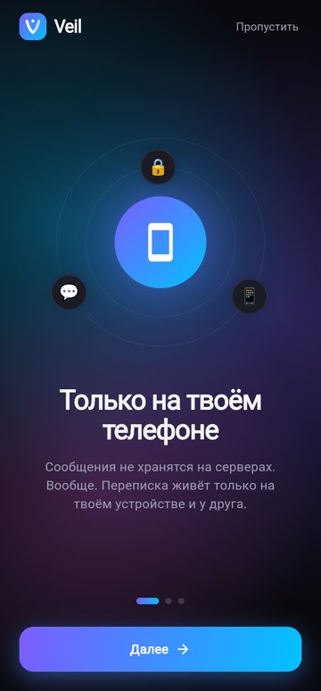
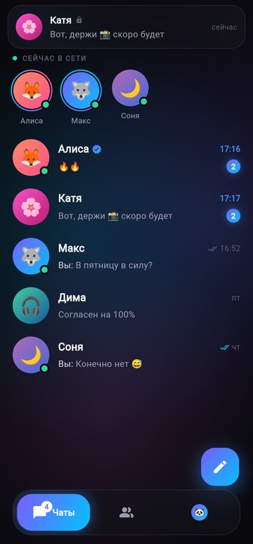
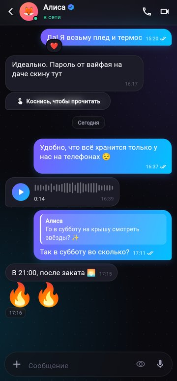
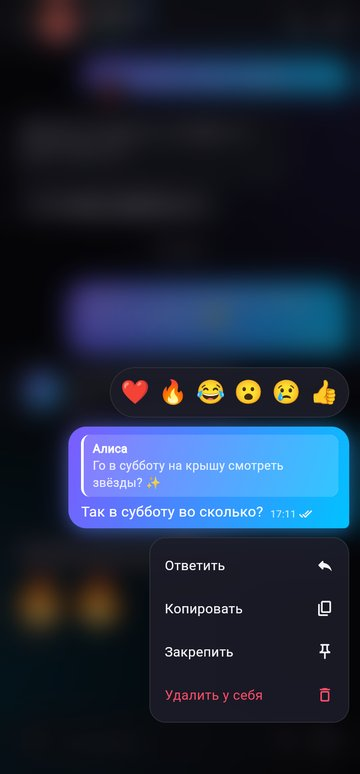
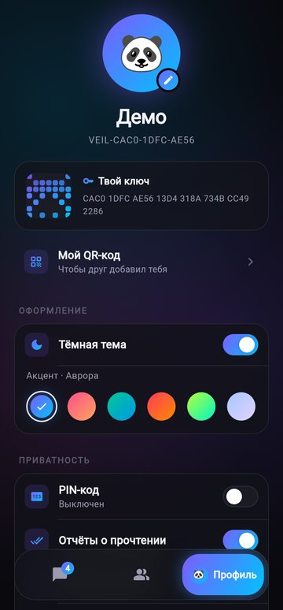
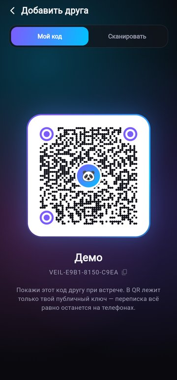
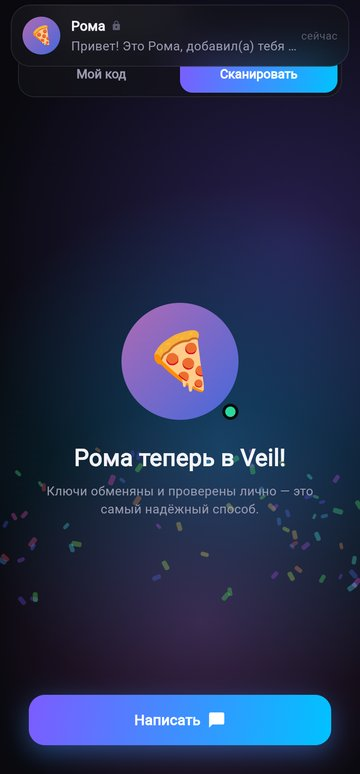
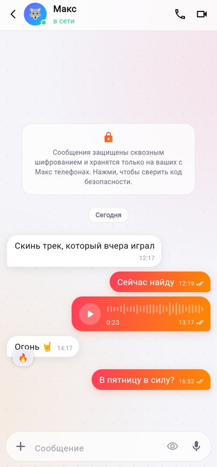

<p align="center">
  
</p>

<h1 align="center">Veil</h1>
<p align="center"><b>Приватный мессенджер для друзей.</b><br>
Сообщения хранятся только на телефонах собеседников — не на сервере. Бесплатно навсегда.</p>

<p align="center">
  
  
  
  
</p>
<p align="center">
  
  
  
  
</p>

> **Статус: фронтенд-прототип.** Все экраны, анимации и жесты работают, но
> друзья и их ответы пока симулируются, а данные живут в памяти (после
> перезапуска всё сбрасывается). Шифрование и доставка — следующий этап.

---

## Что уже есть

**Онбординг**
- 3 слайда с параллаксом и «орбитами» из эмодзи вокруг светящегося шара
- создание профиля без телефона и почты: имя, эмодзи-аватар, цвет
- анимация генерации ключей: символы «проявляются» в отпечаток ключа

**Чаты**
- живой фон «северное сияние», стеклянные панели с размытием
- лента друзей «в сети» с вращающимися градиентными кольцами и пульсирующими точками
- свайп вправо — закрепить, влево — удалить; долгое нажатие — быстрые действия
- «печатает…» с прыгающими точками прямо в списке, черновики, счётчики непрочитанного
- всплывающее стеклянное уведомление о новом сообщении (смахивается вверх)

**Переписка**
- градиентные пузыри с «хвостиками», группировка, даты-разделители
- галочки статуса: ⏱ → ✓ → ✓✓ → ✓✓ цветные (анимированные)
- **свайп вправо по сообщению — ответить** (с вибро-откликом)
- **двойной тап — ❤️** с разлетающимися сердечками
- **долгое нажатие** — фон размывается, появляются реакции и меню
- **секретные сообщения** 👁: размыты, пока не коснёшься; входящие прячутся обратно через 8 сек
- **голосовые**: удерживай микрофон — запись, отпусти — отправка; волна проигрывается
- 1–3 эмодзи в сообщении показываются крупно и «покачиваются»
- меню вложений, кнопка «вниз» со счётчиком новых сообщений

**Друзья и безопасность**
- добавление друга по QR-коду (свой код с вращающейся рамкой, сканер, конфетти 🎉)
- код безопасности: 60 цифр + визуальный «отпечаток», отметка «проверен»
- исчезающие сообщения (настройка на чат), блокировка, очистка переписки
- PIN-код с клавиатурой из стекла, тряской при ошибке и автоблокировкой при сворачивании
- «красная кнопка»: удерживай, чтобы стереть всё с устройства

**Оформление**
- тёмная и светлая тема, 6 акцентных палитр — меняют весь интерфейс на лету
- вибро-отклик почти на каждое действие (можно выключить)

---

## Как получить APK на телефон

### Способ 1. Без установки чего-либо (рекомендую)

APK автоматически собирается на серверах GitHub при каждом изменении кода.

1. Открой репозиторий на GitHub → вкладка **Actions**.
2. Выбери последний зелёный запуск **Build APK**.
3. Внизу в разделе **Artifacts** скачай **veil-apk** (это zip, внутри `veil.apk`).
4. Перекинь `veil.apk` на телефон (через Telegram «Избранное», Google Drive, USB — как удобно).
5. Открой файл на телефоне. Android попросит разрешить установку из этого источника — разреши.

> Если хочешь, чтобы APK появлялся во вкладке **Releases** — создай тег:
> `git tag v0.1.0 && git push origin v0.1.0`.

### Способ 2. Собрать самому на Windows

Понадобится один раз установить инструменты (~10 ГБ места, ~30–40 минут).

1. **Git** — https://git-scm.com/download/win (все галочки по умолчанию).
2. **Android Studio** — https://developer.android.com/studio
   При первом запуске выбери *Standard*, дождись загрузки SDK.
   Затем *More Actions → SDK Manager → SDK Tools* → отметь
   **Android SDK Command-line Tools** → *Apply*.
3. **Flutter** — https://docs.flutter.dev/get-started/install/windows/mobile
   Скачай zip, распакуй в `C:\src\flutter` (не в `Program Files`!).
   Добавь `C:\src\flutter\bin` в PATH:
   *Пуск → «Изменение системных переменных среды» → Переменные среды → Path → Изменить → Создать*.
4. Открой **новое** окно PowerShell и выполни:
   ```powershell
   flutter doctor --android-licenses   # на все вопросы отвечай y
   flutter doctor                      # должны быть зелёные галочки у Flutter и Android toolchain
   ```
5. Скачай проект и собери APK:
   ```powershell
   cd C:\src
   git clone https://github.com/iluxy01/massanger2.git
   cd massanger2
   git checkout claude/secure-messenger-android-dujwud
   flutter pub get
   flutter build apk --release
   ```
   Готовый файл: `build\app\outputs\flutter-apk\app-release.apk`.

**Запуск прямо на телефоне по кабелю** (удобно, когда что-то меняешь):
на телефоне включи *Настройки → О телефоне → 7 раз тапни «Номер сборки»*,
затем *Для разработчиков → Отладка по USB*. Подключи кабель и выполни
`flutter run` — изменения кода подхватываются на лету клавишей `r`.

### Способ 3. Быстро посмотреть в браузере

```powershell
flutter run -d edge --dart-define=DEMO=true
```
`DEMO=true` пропускает онбординг. Вибрации в браузере нет, но всё остальное работает.

---

## Постоянная подпись (необязательно, но полезно)

Без этого каждая сборка в GitHub Actions подписывается случайным ключом,
и чтобы поставить новую версию, старую придётся удалить. Один раз настроим
постоянный ключ:

1. В PowerShell (keytool идёт вместе с Android Studio):
   ```powershell
   & "C:\Program Files\Android\Android Studio\jbr\bin\keytool.exe" -genkey -v `
     -keystore veil.jks -keyalg RSA -keysize 2048 -validity 10000 -alias upload
   ```
   Придумай пароль и **сохрани** его и файл `veil.jks` в надёжном месте.
2. Преврати ключ в текст:
   ```powershell
   [Convert]::ToBase64String([IO.File]::ReadAllBytes("veil.jks")) | Set-Clipboard
   ```
3. На GitHub: *Settings → Secrets and variables → Actions → New repository secret*:
   - `KEYSTORE_BASE64` — вставь из буфера обмена;
   - `KEYSTORE_PASSWORD` — пароль из шага 1.

Всё — следующие сборки будут подписаны твоим ключом. **Никогда не коммить `veil.jks` в репозиторий.**

---

## Структура проекта

```
lib/
  main.dart                 точка входа
  app.dart                  тема, экран блокировки поверх всего, уведомления
  models/models.dart        Profile, Contact, Message
  state/app_state.dart      всё состояние приложения (+ симуляция друзей)
  state/mock_data.dart      демо-друзья и переписка
  theme/palette.dart        цвета тем и акцентные палитры
  widgets/effects.dart      аврора-фон, стекло, кнопки, переключатели, анимации
  widgets/avatar.dart       аватары, кольца, галочки статуса, «отпечаток» ключа
  screens/
    onboarding_screen.dart  слайды, профиль, генерация ключей
    home_screen.dart        стеклянная навигация
    chats_tab.dart          список чатов
    chat_screen.dart        переписка
    contacts_tab.dart       друзья
    contact_screen.dart     профиль друга, код безопасности
    add_friend_screen.dart  QR-код и сканер
    settings_tab.dart       профиль и настройки
    lock_screen.dart        PIN-код
```

---

## Что дальше (бэкенд)

1. **Локальное хранилище** — зашифрованная база SQLite (SQLCipher) на телефоне;
   ключ базы в Android Keystore.
2. **Криптография** — X25519 + Double Ratchet (как в Signal) через libsodium.
   Ключи создаются на телефоне и никогда его не покидают.
3. **Доставка.** Два телефона не могут связаться напрямую без посредника (NAT,
   выключенный экран), поэтому нужен крошечный бесплатный «почтовый ящик»:
   он держит **только зашифрованные** сообщения, пока получатель офлайн, и
   удаляет их сразу после доставки. Варианты на бесплатных тарифах — обсудим.
4. **Уведомления** — без содержимого сообщения (только «есть новое»).
5. Камера для QR, фото, файлы, звонки.
